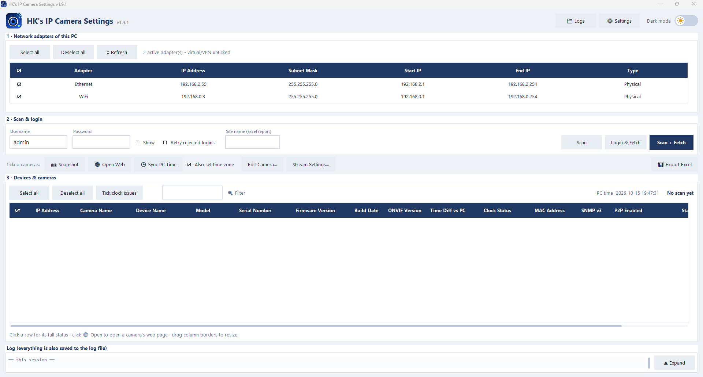
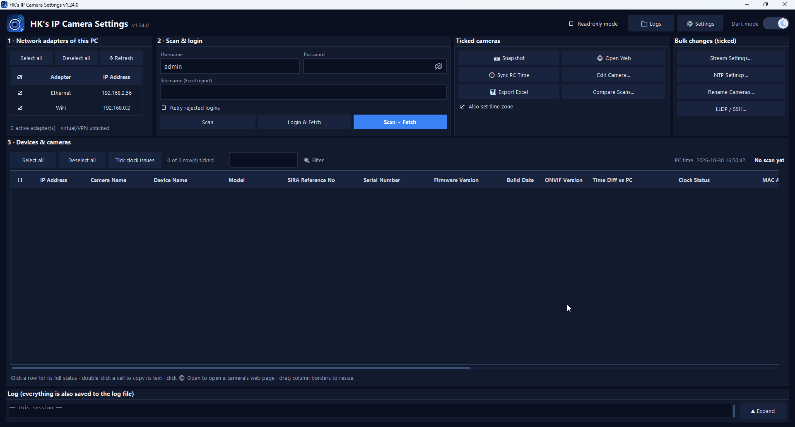
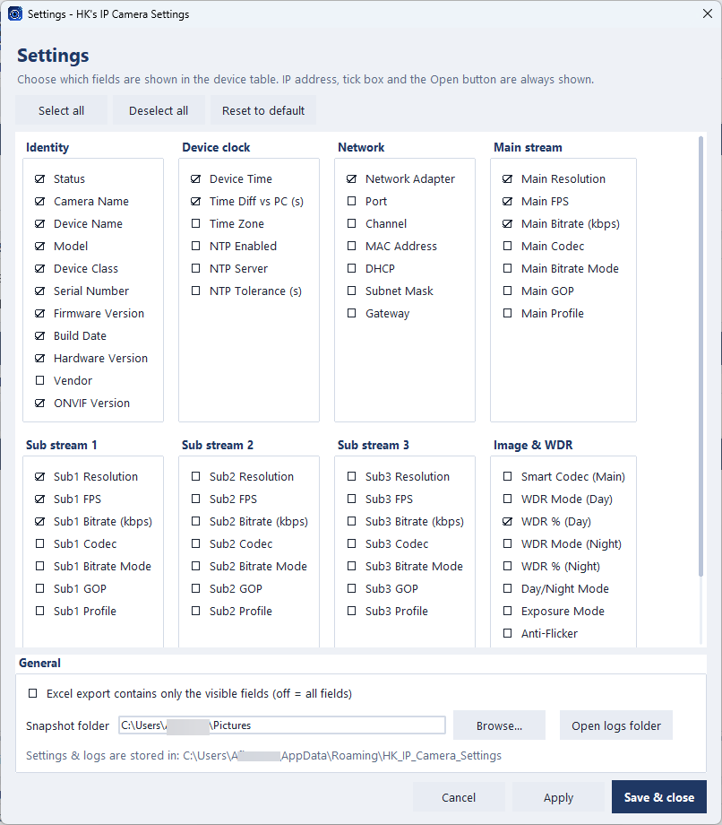

<!-- Images to upload: docs/logo.png, docs/screenshots/light-mode.png, docs/screenshots/dark-mode.png, docs/screenshots/settings.png -->

<p align="center">
  
</p>

<h1 align="center">HK's IP Camera Settings <sub>(Dahua)</sub></h1>

<p align="center">
  <b>A Windows tool for Dahua IP cameras.</b><br>
  Find every camera on your network, log in to all of them at once, check their settings,
  take snapshots, sync their clocks and export everything to Excel.
</p>

<p align="center">
  <a href="https://github.com/kaashifhamid/HKs-IP-Camera-Settings-Dahua/releases/latest"></a>
  
  <a href="https://github.com/kaashifhamid/HKs-IP-Camera-Settings-Dahua/releases"></a>
</p>

---

## ⬇️ Download

Current version: **1.7.1**. Go to the **[Releases page](https://github.com/kaashifhamid/HKs-IP-Camera-Settings-Dahua/releases/latest)** and download one of the two files:

| File | Best for | Notes |
|---|---|---|
| **`HK_IP_Camera_Settings_Setup_1.7.1_x64.exe`** | Normal use | Installer. Installs for your user only, **no administrator rights needed**. Adds a Start Menu entry and an optional desktop shortcut. |
| **`HK_IP_Camera_Settings_Portable_1.7.1_x64.zip`** | USB stick / no installation | Unzip anywhere and run `HK_IP_Camera_Settings.exe`. Logs and settings stay in a `data` folder next to the program. |

> **Requirements:** Windows 10 or 11, 64-bit. Your PC must be on the same network (or a routed network) as the cameras.
> No Python or other software is needed – everything is included.

### First start: Windows SmartScreen

The program is **not yet code-signed**, so Windows may show *"Windows protected your PC"*.
Click **More info → Run anyway**. You can confirm that the download is genuine by comparing its checksum (see [Verify your download](#-verify-your-download)).

---

## ✨ What it does

**1. Finds the cameras on the right network**
- Lists every network adapter of your PC (name, IP address, subnet mask, **start IP and end IP** of the scan range, type) and scans **only the networks you tick**.
- Start IP and End IP show the range that will be scanned (read-only). To scan a custom range, add it under **Extra ranges** in **⚙ Settings**, for example `192.168.1.50-192.168.1.120`.
- Virtual / VPN adapters are unticked by default. Very large networks are narrowed automatically to keep the scan fast; you can add extra ranges (and change the scanned ports) under **⚙ Settings**.

**2. One login for all cameras**
- Enter the username and password once – the app logs in to all devices found.
- **Lockout protection:** a camera that rejected the password is not tried again with the same credentials, so a typo cannot lock your cameras.
- Different password on one camera? Tick just that camera, enter its password and fetch again.

**3. Details before login, and only cameras in the table**
- **Scan** also uses Dahua's own network search (the same method as Dahua's search tools). Without any password, every device that answers shows its **model, serial number, firmware version, MAC address, device name and class** right after the scan.
- Only cameras (fixed, dome, PTZ, thermal and traffic/ITC) are shown. NVRs/DVRs, switches, door stations, access controllers and other brands are **hidden from the table**, whether they were recognised by the search or after login. They are listed with the reason in the Excel *Scan Info* sheet and the log.
- Devices that rejected the password stay in the table, with their details, so you can enter their own password and fetch again.
- Devices found by the network search outside the scanned range (for example a camera left on a wrong subnet) are shown and marked *other subnet*.

**4. Detailed camera information**

| Group | Fields |
|---|---|
| Identity | Camera name, device name, model, device class, serial number, firmware version, build date, hardware version, **SD card slots** (optional column, switch it on in Settings), vendor |
| Network | IP address, MAC address, DHCP, subnet mask, gateway, network adapter it was found on, **SNMP v3** (Yes / No / Unknown – whether the camera offers SNMP v3, not whether it is enabled; *No* = the camera's firmware has no SNMP section) |
| Streams | **Main + Sub 1–3:** resolution, FPS, bitrate, codec, bitrate mode, GOP, profile |
| Image | **WDR mode and WDR % (day / night)**, smart codec, day/night mode, exposure mode, anti-flicker, brightness, contrast, saturation |
| Clock | **Live device date & time**, difference to your PC, time zone, NTP on/off, NTP server, NTP tolerance |

**5. Time sync** – one click sets the clock of all ticked cameras to your PC time and **verifies** the result. Tick **Also set time zone** next to the button to set each camera's time zone to your PC's as well (read back to confirm; the old and new zone are logged). Cameras that keep a wrong time (for example because NTP is enabled) are reported with the reason.

**6. Snapshots** – tick the cameras and click **Snapshot**. Every camera saves a JPEG with the **camera name in the bottom-right corner**, named like `2026-10-09 095822 AK0B69APAG01456.jpg` (date, time, serial number).

**7. Open web interface** – click **🌐 Open** in any row (or select several cameras and use **Open Web**) to open the camera's own web page in your browser.

**8. Excel export** – one row per camera channel, plus a *Scan Info* sheet that documents the scan. Choose whether to export all fields or only the visible ones.

**9. Edit a camera's names** – select one camera and click **Edit Camera...** (or right-click → *Edit camera name...*) to change its **on-screen camera name** and its **device name**. Each change is read back from the camera to confirm it, and the old and new values are written to the log.

**10. Stream settings in bulk** – tick any number of cameras and click **Stream Settings...** to change the **resolution, FPS, bitrate, codec, CBR/VBR and GOP** of the **main stream and sub streams 1–3** at once.
- A **preview** compares your values with what each camera supports (resolutions, maximum FPS, bitrate range) and shows exactly what will change. Values a camera cannot take are marked in red with the reason, and nothing is written until you click **Apply**.
- After writing, every value is **read back** from the camera; if a camera adjusts a value, you see what it stored instead.
- **Undo last change** restores the previous values.

**11. Comfort**
- **Settings page** to choose which fields are shown in the table, and to set **extra scan ranges** and **ports**.
- A clean layout with the adapters in an evenly spaced table, username and password on one line next to the scan buttons, larger entry fields and rows, and only **Scan + Fetch** highlighted.
- **Filter box** above the device table to find cameras by IP, model, name or status. Hidden rows are never ticked or used by actions.
- **Collapsible log** at the bottom (click **Expand**); everything is still saved to the log file.
- The device table has the **Status** and **Web** columns at the end.
- **Dark mode** with an animated switch.
- Tick boxes with *Select all / Deselect all*, resizable columns, centered table.
- **Everything is logged** to a daily log file, also after the app is closed – including every failed request with the camera's reply, a session ID, information about the PC, and a crash log. A **diagnostic bundle** (logs + settings + PC information, no passwords) can be saved from *Settings* in one click, and *Detailed logging* can record every request when a problem is being investigated.

---

## 🖼️ Screenshots

| Light mode | Dark mode |
|---|---|
|  |  |

Switch between the two with the sun / moon switch in the top-right corner of the window.

**Settings page** – choose which fields are shown in the device table, whether the Excel export uses only the visible fields, where snapshots are saved, and the extra scan ranges and ports:

<p align="center">
  
</p>

---

## 🚀 Quick start

1. **Install** (or unzip the portable version) and start **HK's IP Camera Settings**.
2. In **① Network adapters**, tick the adapter that is connected to your camera network.
3. In **② Scan & login settings**, enter the camera **username** and **password**. The default ports `80, 8080, 443` fit most cameras; change them (or add extra ranges) in **⚙ Settings**.
4. Click **Scan + Fetch**. The cameras appear in the table (green = verified IP camera, red = needs attention – click the row for the reason; NVRs, switches and other non-camera devices are not shown).
5. Use the toolbar:

| Button | What it does |
|---|---|
| **Scan** | Searches the network and shows model, serial number, firmware and MAC address of the cameras found (no login) |
| **Login & Fetch** | Logs in to the ticked devices and reads their details |
| **Scan + Fetch** | Both steps in one go |
| **📷 Snapshot** | Saves a JPEG of every ticked camera |
| **🌐 Open Web** | Opens the web pages of the ticked / selected cameras |
| **🕒 Sync PC Time** | Sets the ticked cameras' clock to your PC time (tick **Also set time zone** to set the time zone too) |
| **Export Excel** | Saves the ticked cameras to an `.xlsx` file |
| **Edit Camera...** | Changes the camera name and device name of one camera |
| **Stream Settings...** | Changes resolution, FPS, bitrate, codec, CBR/VBR and GOP of the main / sub streams of the ticked cameras (with preview and undo) |

**Tips**
- Tick boxes decide what is exported, photographed or synchronised.
- Double-click a row or click **🌐 Open** to open that camera's web page.
- Drag the column borders to resize columns; open **⚙ Settings** to hide fields you don't need.

---

## ⚙️ Settings, logs and portable mode

| Item | Location |
|---|---|
| Logs (daily files, kept 90 days) | `%APPDATA%\HK_IP_Camera_Settings\logs` – open it with the **📁 Logs** button |
| Settings | `%APPDATA%\HK_IP_Camera_Settings\settings.json` |
| Crash log | `%APPDATA%\HK_IP_Camera_Settings\logs\crash.log` |
| Diagnostic bundle | **⚙ Settings → Save diagnostic bundle...** (a zip with logs, settings without the user name, and PC information – no passwords) |
| Portable version | the `data` folder next to `HK_IP_Camera_Settings.exe` (because of the included `portable.txt`) |

The installer's uninstaller **keeps** your logs and settings.

---

## 🔒 Privacy and safety

- The program talks **only to the cameras on your own network** (it sends a local search message to find them; it does not leave your network). It sends no data to the internet and has no telemetry.
- The **password is never saved** – not in the settings file and not in the log.
- The program only **reads** from your cameras, except for the actions you start yourself: **Sync PC Time** (changes the camera clock and, if ticked, its time zone), **Edit Camera** (changes names) and **Stream Settings** (changes stream parameters, after a preview and a confirmation, with read-back and undo). Every change is written to the log with the old and new value.
- Logs and diagnostic bundles contain device information (IP, model, serial number, firmware) but **never passwords**. Keep that in mind before sharing them.

---

## ❓ Troubleshooting

| Problem | What to try |
|---|---|
| A camera shows **Login failed – Wrong username/password** | That camera uses a different password. Tick only that camera, enter its credentials and click **Login & Fetch**. |
| A camera shows **Access refused (HTTP 403)** | The account is most likely **locked** after failed logins. Wait about 30 minutes or restart the camera, then try again. |
| No cameras found | Make sure the right adapter is ticked, the PC and cameras are in the same subnet (or add a range under *Extra ranges* in **⚙ Settings**), and the ports match the cameras' HTTP port. |
| **SNMP v3** shows *No* | The camera's firmware has no SNMP section (the camera answers "Bad Request"). Some models can get a custom firmware with SNMP. |
| **SNMP v3** shows *Unknown* | The camera did not answer the SNMP request or returned something unexpected. Open the log, find the line `SNMP v3 check <ip>` and send it with the camera model so the detection can be extended. |
| A device is missing from the table | NVRs/DVRs, switches, door stations and non-Dahua devices are not shown as cameras. They appear with the reason in the Excel *Scan Info* sheet and in the log. |
| Model / serial / firmware are empty after **Scan** | The camera did not answer the network search (Wi-Fi isolation, another subnet, or a firewall that blocks UDP). Windows may ask whether the program may use the network: allow it on **private** networks. Login & Fetch still reads everything with the password. |
| The program does not open a second window | By design only one window runs at a time; a second start brings the open window to the front. |
| *Sync PC Time*: **clock still off** | The camera accepted the new time but its clock did not move. The message in the log tells the likely reason: **NTP enabled** on the camera (check the NTP server / time zone), or the camera is kept in time by an **NVR / recorder** (check the NVR's time-sync option). Run *Sync PC Time* again for those cameras. |
| *Sync PC Time* with **Also set time zone**: "time zone not available" / "not changed" | The PC's UTC offset is not in the camera's time zone list, or the camera kept its old zone. Set it in the camera's web page. Daylight-saving changes are not handled by the camera setting. |
| *Stream Settings*: a value is marked red or "adjusted" | Red = the camera does not support that value (resolution list, maximum FPS and bitrate range are checked per camera) – the reason is shown. "Adjusted" = the camera accepted the change but stored a different value; the table shows what it kept. Cameras recorded by an NVR may be controlled by the NVR – try one camera first. |
| Excel export or the snapshot folder window does not open | Some PCs cannot show the standard Windows file dialog. The app then uses its own dialog, or saves automatically to `Documents\HK IP Camera Settings` (Excel) or the snapshot folder from *Settings*, and says so in the log. |
| Snapshot has a different size than the main stream | The snapshot comes from the camera's snapshot function; some models use another resolution. |
| Windows warns when starting | See [First start: Windows SmartScreen](#first-start-windows-smartscreen). |

---

## 🔐 Verify your download

Compare the SHA-256 checksum of the file you downloaded with the values below (PowerShell):

```powershell
Get-FileHash .\HK_IP_Camera_Settings_Setup_1.7.1_x64.exe -Algorithm SHA256
```

**Version 1.7.1**

| File | SHA-256 |
|---|---|
| `HK_IP_Camera_Settings_Setup_1.7.1_x64.exe` | `a9eaf3d0975786ebac7bb727e044031222feb107d96feaac5d3084b5425afda9` |
| `HK_IP_Camera_Settings_Portable_1.7.1_x64.zip` | `bbe8a8a0f24150f212e35d53a60695511c171346d778befdeac7e16b8994b858` |

---

## 📝 Release notes

| Version | Highlights |
|---|---|
| **1.7.1** | **New:** optional column **SD Card Slots** (how many memory cards the camera supports; hidden by default, switch it on in **⚙ Settings**). |
| **1.7.0** | **New:** Scan uses Dahua's network search, so model, serial number, firmware, MAC address, name and class are shown **without a password**; non-camera devices (NVR, switch, door station ...) are **hidden from the table** and listed on the *Scan Info* sheet; cameras on another subnet are marked; *MAC Address* is shown by default. **Faster start:** no slow Windows system query (also stops the messages in `crash.log` on some PCs); **only one window** at a time. |
| **1.6.2** | **Fix:** *SNMP v3* now shows **No** for cameras whose firmware has no SNMP (they answer "Bad Request" for it) instead of *Unknown*; *Unknown* is kept for cameras that do not answer. Checked against logs from 7 camera models. |
| **1.6.1** | **New:** column **SNMP v3** (Yes / No / Unknown: does the camera offer SNMP v3; the raw SNMP reply is written to the log for checking). **Change:** Start IP / End IP are read-only table columns (custom ranges via *Extra ranges* in Settings). |
| **1.6.0** | **New look:** network adapters in a full-width, evenly spaced table with **Start IP / End IP**; username, password and scan buttons on one line; buttons grouped by purpose; larger entry fields and table rows; **filter box** for the device table; collapsible log. |
| **1.5.1** | **Layout:** network adapters and scan & login side by side, Notes column removed, larger device table, **Status** and **Web** columns moved to the end, extra ranges and ports moved to **⚙ Settings**. **New:** *Sync PC Time* can also set the camera's **time zone** (option next to the button, verified by read-back). |
| **1.5.0** | **New:** edit a camera's name and device name; **bulk stream settings** (resolution, FPS, bitrate, codec, CBR/VBR, GOP for main and sub streams) with capability check, preview, read-back and undo; **more detailed logs** (failed requests with the camera's reply, session ID, PC information, crash log, optional full request trace) and a one-click **diagnostic bundle**. |
| **1.4.3** | **Fixes:** Excel export and snapshot folder now work even when Windows cannot open its file dialog ("Unspecified error"). *Sync PC Time* now reads the clock back several times, retries once and shows the real reason when a camera keeps its old time. |
| **1.4.2** | Native 64-bit program and 64-bit installer, portable x64 package. |
| **1.4.1** | Traffic (ITC) cameras recognised; *Sync PC Time* now verifies the result and explains NTP cameras; new fields: time zone, NTP enabled / server / tolerance. |
| **1.4.0** | New name *HK's IP Camera Settings*; persistent log file; live device clock; *Sync PC Time*; Settings page; per-row *Open*; modern scrollbars; animated dark mode. |
| **1.3.0** | Logo, unified tick boxes, snapshots with camera-name overlay, open web interface. |
| **1.2.0** | New table design, centered columns, lockout protection. |
| **1.1.0** | Discovery by network adapter, only verified Dahua IP cameras exported. |
| **1.0.0** | First release. |

### Planned

- ONVIF check (enabled / disabled) per camera
- View P2P status and enable / disable it in bulk
- Code-signed installer

---

## 💬 Feedback

Found a problem or have an idea? Please open an **[Issue](https://github.com/kaashifhamid/HKs-IP-Camera-Settings-Dahua/issues)** and include the version number (shown in the window title) and, if possible, the relevant lines from the log file.

---

## ⚖️ License and notices

© HK. All rights reserved. The program is provided **free of charge, as is, without warranty**. Use it only on networks and devices you are authorised to manage.

Dahua and other product names are trademarks of their respective owners. This is an independent tool.
